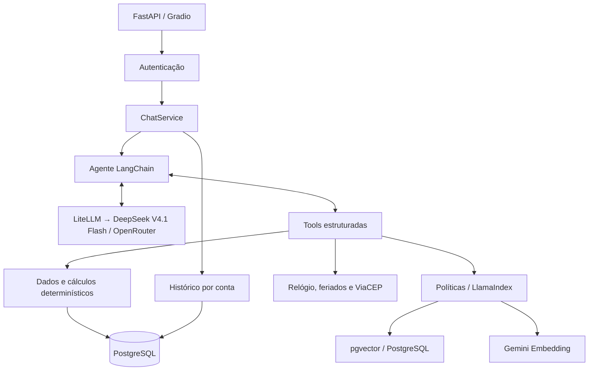

# HarmonIA — assistente da Empório da Música

Protótipo de agente de atendimento em **Python**, desenvolvido para o desafio
técnico de AI Engineer da Artefact.

O objetivo é reduzir a sobrecarga da equipe da Empório da Música, loja fictícia de
instrumentos musicais de Campo Grande/MS, respondendo dúvidas recorrentes com base
nos dados operacionais e nas políticas da loja. A HarmonIA combina consultas
estruturadas e recuperação de conhecimento para oferecer respostas contextualizadas,
mantendo explícitas as limitações do atendimento automatizado.

**[Acessar demonstração](https://emporio-da-musica.150.136.10.184.nip.io)**

> Para acessar uma conta de demonstração já cadastrada a partir da lista de
> clientes, use o e-mail do cliente e a senha padrão **`senha12345`**.

## Navegação rápida

| Assunto | Links |
|---|---|
| Execução | [Configurar ambiente](#executar-com-docker) · [Construir e iniciar](docs/docker.md#construir-e-iniciar) · [Acessar](docs/docker.md#acessar) · [Operação Docker](docs/docker.md) |
| Arquitetura | [Visão geral](#arquitetura-e-decisões-técnicas) · [Decisões técnicas](docs/decisoes-tecnicas.md) · [Agente](docs/agente.md) |
| Dados e ferramentas | [Ingestão](docs/ingestao-de-dados.md) · [RAG](docs/rag.md) · [Tools](docs/tools.md) · [Consultas externas](docs/consultas-externas.md) |
| Interface e acesso | [Autenticação e contas demo](docs/autenticacao.md) · [API](docs/api-chat.md) · [Interface](docs/interface-chat.md) |
| Qualidade e avaliação | [Verificações locais](docs/qualidade-de-codigo.md#verificações-locais) · [Benchmarks](docs/benchmarks.md) · [Resultados e custos](docs/decisao-rag-e-custos.md) |
| Desenvolvimento | [Limitações e evolução](#avaliação-e-limitações) · [Uso de IA](#uso-de-ia-no-desenvolvimento) |

## Funcionalidades

- Consulta de catálogo, preços, estoque e promoções.
- Simulações de pagamento e consulta de condições de entrega.
- Respostas sobre horários, garantia, trocas, devoluções e políticas da loja.
- Consulta dos pedidos vinculados à conta autenticada.
- Registro de reclamações com protocolo, sem encaminhamento humano automático.
- Histórico de conversas por conta, com retomada na interface.
- Tratamento cordial de perguntas fora do escopo da loja.

O atendimento usa a persona HarmonIA, em português brasileiro, com tom acolhedor,
informal e profissional. As ferramentas não executam compras, pagamentos,
reservas, cancelamentos ou reembolsos.

## Executar com Docker

### Pré-requisitos

- Git, Docker e **Docker Compose v2** (`docker compose`).
- Acesso à internet e chaves com cota/créditos disponíveis para **OpenRouter**
  (chat) e **Google Gemini API** (embeddings).
- Portas locais `8000` e `5432` disponíveis, ou outras configuradas no `.env`.

Não é necessário instalar Python ou PostgreSQL no host para executar com Docker.

### Clonar e preencher o ambiente

```bash
git clone https://github.com/vs-machado/ai-agent-emporio-da-musica.git
cd ai-agent-emporio-da-musica
git switch develop
cp .env.example .env
```

Edite o `.env`. Para a configuração padrão, preencha:

| Variável | Configuração |
|---|---|
| `POSTGRES_DB`, `POSTGRES_USER`, `POSTGRES_PASSWORD` | Credenciais do banco; o exemplo inclui valores locais |
| `AUTH_JWT_SECRET` | Segredo aleatório próprio com pelo menos 32 caracteres |
| `DEMO_PASSWORD` | Senha inicial das contas demo, de 10 a 128 caracteres |
| `OPENROUTER_API_KEY` | Chave para o modelo de chat DeepSeek via OpenRouter |
| `GOOGLE_API_KEY` | Chave para indexar o manual e gerar embeddings das consultas |

Para gerar o segredo JWT usando apenas Docker:

```bash
docker run --rm python:3.12-slim python -c "import secrets; print(secrets.token_urlsafe(48))"
```

Copie o resultado para `AUTH_JWT_SECRET`. As chaves e o `.env` não devem ser
publicados. O exemplo completo está em [`.env.example`](.env.example).

O chat usa `CHAT_PRIMARY_MODEL=openrouter/deepseek/deepseek-v4.1-flash` e os
embeddings usam `RAG_EMBEDDING_MODEL=gemini-embedding-001`, com 768 dimensões.
`CHAT_FALLBACK_MODEL` fica vazio por padrão. A chave de chat não substitui a chave
de embeddings: a primeira indexação precisa de acesso válido à API Google.

Após preencher o ambiente, siga os guias de **[construção e inicialização](docs/docker.md#construir-e-iniciar)**
e **[acesso à aplicação](docs/docker.md#acessar)**. O Compose executa migrations,
ingestão, indexação e seed automaticamente. Para publicação HTTPS, consulte a
[configuração do proxy e dos cookies](docs/autenticacao.md#https-atrás-do-coolify-ou-de-outro-proxy).

## Arquitetura e decisões técnicas



| Escolha | Justificativa |
|---|---|
| **LangChain + tool calling e RAG** | Orquestra consultas por ferramentas com schemas definidos e acessa as políticas por RAG com chunking estrutural (structure-aware), busca vetorial e fallback textual, mantendo SQL, autorização e cálculos fora da LLM |
| **DeepSeek via OpenRouter / LiteLLM** | Melhor comportamento observado no catálogo e nas ferramentas durante o desenvolvimento, com custo competitivo e acesso desacoplado do provedor |
| **FastAPI + Gradio** | API e interface de chat em Python, compartilhando o mesmo serviço de atendimento, sem frontend separado |
| **PostgreSQL, SQLAlchemy e Alembic** | Persistência transacional de dados, contas e conversas, com schema versionado |
| **LlamaIndex + pgvector** | Implementa o RAG com chunks por seção/subseção, busca vetorial por similaridade de cosseno e fallback para busca textual PostgreSQL em caso de falha vetorial, preservando evidências e metadados |

**Dados e ingestão.** Os seis CSVs de `agent-data/` são validados antes de uma
carga transacional com upsert: tipos, valores monetários, status, JSON e
relacionamentos. Os arquivos originais são preservados. Preços históricos e datas
de recebimento ausentes não são inferidos. Consulte [ingestão](docs/ingestao-de-dados.md).

**RAG.** Somente `kb/políticas_da_loja.pdf` é indexado; os CSVs são consultados como
dados relacionais. O chunking segue a estrutura de seções/subseções do manual e
preserva listas, tabelas e referências. O manual atual produz 25 chunks, com
embeddings Gemini de 768 dimensões, busca por cosseno, `top_k=5` e orçamento de
aproximadamente 2.000 tokens de contexto. Falhas vetoriais acionam busca textual
PostgreSQL; isso não é busca híbrida. Para um PDF curto, uma abordagem mais simples
também seria possível; a escolha permite demonstrar RAG e evoluir a base.

A estratégia foi mantida após comparar busca vetorial, `top_k=10` e BM25 + RRF:
não houve ganho consistente que justificasse a complexidade adicional. Detalhes
em [RAG](docs/rag.md) e [decisão de RAG e custos](docs/decisao-rag-e-custos.md).

**Prompt.** O [system prompt](app/agents/prompt.py) define persona, tom, fontes
obrigatórias e tratamento de ambiguidades e perguntas fora do escopo. O agente
deve consultar dados antes de afirmar preço, estoque ou status, usar políticas
para regras da loja e não prometer operações inexistentes. As evidências apoiam
a resposta sem expor referências documentais ao cliente. Autorizações e cálculos
continuam validados pelo backend, independentemente do prompt.

**Histórico.** Conversas e turnos completos, incluindo chamadas e resultados de
ferramentas, ficam no PostgreSQL e podem ser retomados por conta. IDs de solicitação
evitam reexecutar turnos já concluídos, e a titularidade de conversas e pedidos é
verificada no backend. Detalhes em [agente](docs/agente.md),
[autenticação](docs/autenticacao.md) e [decisões técnicas](docs/decisoes-tecnicas.md).

## Avaliação e limitações

O projeto usa pytest para validações, contratos e integração; Ruff para lint e
formatação; e Ragas para avaliar respostas reais em 38 casos. Os benchmarks usam
MiMo-V2.6-Flash como juiz e consideram RAG Triad, uso de ferramentas, tokens e
latência. Na linha de base vetorial, a relevância do contexto foi **89,6%**, a
fundamentação **82,2%** e a relevância da resposta **71,4%**.

Essas médias são de uma execução e não garantem correção em todo atendimento.
Consulte a metodologia, os resultados e suas ressalvas:

- [Benchmarks: dataset, métricas e execução](docs/benchmarks.md).
- [Resultados da linha de base vetorial](docs/benchmark-baseline-rag-vetorial.md).
- [Resultados da busca híbrida BM25 + RRF](docs/resultados-busca-hibrida.md).
- [Comparação vetorial com top-k 5 e 10](docs/benchmark-comparacao-top-k.md).
- [Decisão de RAG e estimativas de custo](docs/decisao-rag-e-custos.md).
- [Verificações locais: lint, formatação e testes](docs/qualidade-de-codigo.md#verificações-locais).

Limitações e próximos passos priorizados:

- **Erros da LLM:** ainda pode haver interpretação equivocada, informação sem
  suporte suficiente ou promessa incompatível com as capacidades do sistema.
- **Revisão dos benchmarks:** `factual_correctness` registrou **31,9% em 20 casos**
  na linha de base. É necessário revisar referências, critérios e respostas caso
  a caso e repetir a avaliação. Problemas metodológicos são uma hipótese, não
  uma explicação comprovada nem motivo para descartar erros reais.
- **Redundância de provedores:** o mecanismo de fallback de chat existe, mas está
  desativado por padrão. Falta selecionar e validar um modelo alternativo e
  ampliar a redundância dos serviços de IA, incluindo embeddings.
- **Atendimento humano:** integrar encaminhamento, acompanhamento e confirmação
  de solicitações. Hoje, registrar uma reclamação gera protocolo no banco, sem
  notificar a equipe ou garantir retorno.
- **Frete para outras regiões:** adicionar ferramenta de pesquisa na internet
  para obter dimensões dos produtos e evoluir o cálculo de frete. Atualmente,
  ViaCEP informa endereço, não tarifa; destinos externos dependem de confirmação
  com um funcionário. Pesquisa de dimensões e cálculo externo ainda não existem.

## Uso de IA no desenvolvimento

Foi utilizado **OpenCode com GPT-6.1 Sol** como apoio ao desenvolvimento. As
tecnologias foram definidas com auxílio da IA, que também analisou a estrutura
dos documentos para apoiar as decisões sobre ingestão e RAG. A técnica escolhida
considerou tanto a organização do manual de políticas quanto os resultados dos
benchmarks executados.

Os prompts foram elaborados inicialmente com IA e refinados manualmente de forma
iterativa. Conversas armazenadas no banco foram fornecidas como insumo para a IA
sugerir alterações, com revisão e direcionamento do desenvolvedor.

O GPT-6.1 Sol é o modelo do assistente de código; o modelo de atendimento da
aplicação é o **DeepSeek V4.1 Flash** (`openrouter/deepseek/deepseek-v4.1-flash`).
O **Gemini Embedding** (`gemini-embedding-001`) é usado nos embeddings e o
**MiMo-V2.6-Flash** (`xiaomi/mimo-v2.6-flash`) nas avaliações registradas.

**Exemplos de interação:** os 3 a 5 exemplos de conversas exigidos pelo desafio
serão adicionados em uma etapa posterior.
